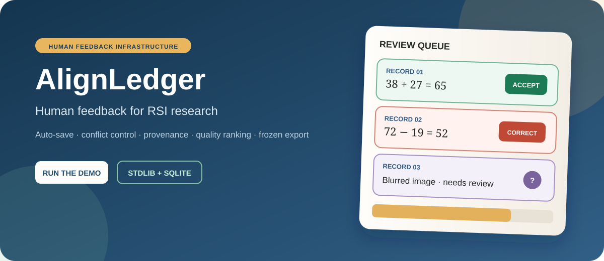
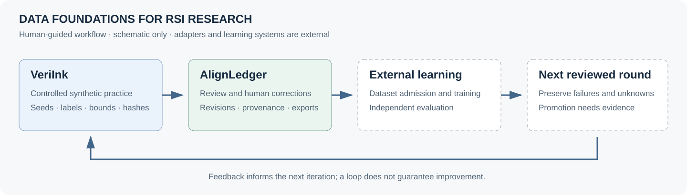
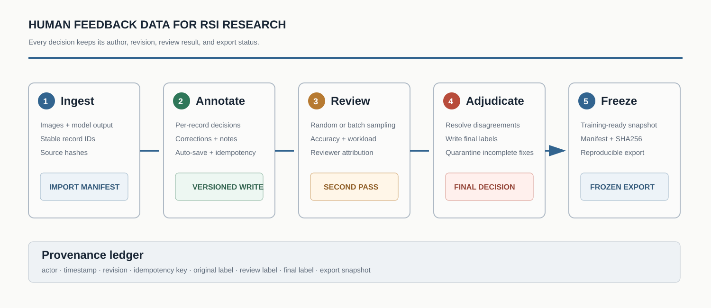

<p align="right"><a href="README.md">English</a> · <strong>中文</strong></p>

<div align="center"></div>

# AlignLedger

AlignLedger 是一套面向 RLHF、SFT、DPO/KTO 和多模态评测的数据标注与质量管理工具。模型输出、人工修正、二次复核、人员归属和最终导出都保存在可追踪的记录里。

项目只依赖 Python 标准库和 SQLite，不需要前端构建环境。一条命令即可启动本地演示，程序会生成已完成、部分完成、人工修正和待确认等仿真数据。

## 在 RSI 中负责什么

**AlignLedger 为 RSI 研究与持续模型迭代准备人类反馈和可追溯数据。** 模型输出经初标、复核和最终修正后，形成带版本、来源与哈希的冻结快照，供后续训练和独立评测使用。

这里的 RSI 指递归自改进：上一轮证据用于指导下一轮。平台负责数据审核与交接；[VeriInk](https://github.com/znxzsy/VeriInk) 提供互补的合成练习，训练器与评测器由外部流程接入。

<p align="center"></p>

| 数据环节 | 平台提供的能力 |
| --- | --- |
| 复核模型输出 | 逐条判断、人工修正和无法判断状态 |
| 处理分歧 | 独立保存二次复核与最终标签 |
| 追溯决策 | 操作者归属、版本与幂等写入 |
| 准备下一轮数据候选 | 冻结文件、manifest、SHA256 与完成标记 |
| 将反馈交给后续迭代 | 交接规范；领域适配与数据隔离策略由外部落实 |

冻结导出仅说明快照已生成，不自动代表训练准入。人工标签仍需符合具体审核协议；模型生成标签不能直接算人工金标。DPO/KTO 候选文件仍需下游验证与格式适配。

[RSI 数据流程](docs/RSI_WORKFLOW_ZH.md) · [English](docs/RSI_WORKFLOW.md) · [虚构轮次记录](examples/rsi_round.example.json)

## 为什么做这个项目

多人标注经常出在细节上：旧页面覆盖新结果，网络重试造成重复写入，看板显示完成但个别记录仍为空，导出后又说不清是谁改过标签。AlignLedger 给每次写入加上版本号和幂等键，保留修改历史，也把初标、复核和最终裁决分开保存。

未完成最终修正的数据不会混进冻结版。

## 数据流程

<p align="center"></p>

复核人员可以随机抽样，也可以指定批次。质量榜单同时统计准确率和工作量，所有数字都从服务端记录重新汇总，不依赖浏览器缓存。

## 主要能力

- 逐条标注、人工修正和明确的待确认状态
- 草稿自动保存、版本冲突保护和幂等写入
- 邀请码绑定姓名，保留标注与复核人员归属
- 正常、需修正和待确认数据分池处理
- 随机复核、指定批次复核和最终标签裁决
- 分别统计标注量、复核量和准确率
- 导出 manifest、SHA256 与 `FROZEN_OK`

## 快速开始

```bash
git clone https://github.com/znxzsy/AlignLedger.git
cd AlignLedger
./scripts/run_demo.sh
```

浏览器打开 [http://127.0.0.1:18068](http://127.0.0.1:18068)。首次运行会生成 12 组仿真数据。

也可以使用 Docker：

```bash
docker compose up --build
```

## 导入自己的数据

```bash
python -m annotation_platform.importer \
  --details-dir ./my-details \
  --output-dir ./runtime/imported

python -m annotation_platform.server \
  --registry ./runtime/imported/source_groups.jsonl \
  --db ./runtime/review.sqlite3 \
  --audit ./runtime/audit.jsonl
```

导入器会拒绝不安全的本地图片路径，检查数据结构，计算源文件哈希，并生成可复查的 manifest。

## 多人部署与实名邀请码

本地演示默认关闭认证。共享部署时应使用随机会话密钥与一次性邀请码：

```bash
mkdir -p secrets runtime
python -c 'import secrets; print(secrets.token_hex(32))' > secrets/session-secret
python scripts/generate_invites.py --count 30

export ANNOTATION_AUTH_REQUIRED=1
export ANNOTATION_SESSION_SECRET_FILE=secrets/session-secret
export ANNOTATION_COOKIE_SECURE=1
./scripts/run_demo.sh
```

邀请码首次使用时绑定姓名，服务端只保存邀请码哈希。`runtime/invites.txt` 中的明文邀请码不能提交到 Git。

## 测试

```bash
python -m unittest discover -s tests -v
python -m compileall -q annotation_platform scripts tests
```

测试覆盖部分未标筛选、占位数据保护、复核修正、演示数据库、HTTP API 和主要页面。

## 公开数据边界

仓库只包含仿真数据。真实标注数据库、审计日志、邀请码、学生图片、身份映射、私有截图、凭证、内部地址和导出数据都不能提交。详细说明见 [SECURITY.md](SECURITY.md)。

## 合作

如果需要按业务数据格式适配、私有化部署或接入训练导出，可以通过微信 **`znxzsy`** 联系。

## License

[MIT](LICENSE)
